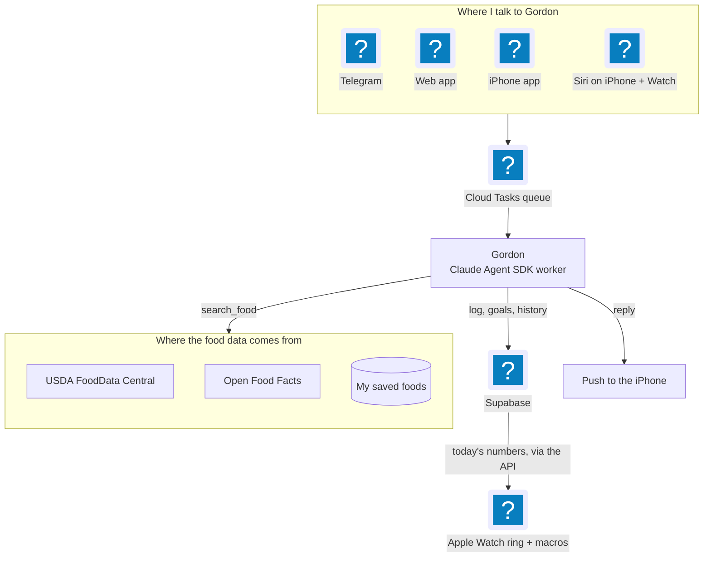

A trip to Punta Cana got booked on impulse. A few days later I stepped on the scale and the number was not Dark Knight worthy. I'm not telling you the number. I'll tell you the part that annoyed me: I do a lot of CrossFit and a lot of kitesurfing, and none of it was showing up. Training hard and eating without any record of it means the scale is the only feedback you get, and the scale is a lagging, rude instrument.

I had a food-tracking agent. I just wasn't using it for real. I sketched the whole cast in [the architecture post](/blog/2026-06-01-behind-project-batcave-multi-agent-architecture), and Gordon, the nutrition one, was a Telegram bot I poked at when I remembered. Remembering was the problem. So Gordon became the thing I log with every day, and for the two weeks before leaving (the weekend of October 24) I've tracked exclusively on it. MyFitnessPal is fully replaced.

To be clear about the timeline: the app work runs from August to October. The two weeks are just how long I've lived on it with a departure date attached. The deadline is what made me fix things as I hit them instead of putting them on a list.

This post is the what. The rest of the series goes underneath it: how a one-user Telegram bot got reorganized into a platform the web and phone apps share, what Gordon actually remembers, the eight eval suites and the day they were testing a different agent than production, and the food adapters where the bugs turned out to be arithmetic, units and a cheeseburger.

{/*  */}

## What actually replaced MyFitnessPal

I didn't set out to clone it feature for feature. I just kept hitting the moment where I'd think "I need to open the old app for that" and then fixing that moment. Grouped by what they do:

| Job | What Gordon does now |
|---|---|
| Finding food | Search that ranks the food you meant first, backed by USDA FoodData Central and Open Food Facts. Barcode scan that falls back to "Photograph the label" and saves the product so the next scan resolves from cache. |
| Logging fast | Copy yesterday's meals, saved meals and recipes, favorites. A photo of a plate or label goes to Gordon, and under his reply is one row per logged entry with Undo and Edit. |
| Reading the numbers | A diary with day navigation, 14 micronutrients, water and caffeine, a weekly report, and trends you can scrub, where each macro shows where its number came from. |
| Setting targets | A goal wizard, plus opt-in adaptive calorie targets that learn from what I ate and what the scale did. |
| Deciding what to eat | A pantry filled from a receipt, and EAT NEXT suggestions that read it. |
| Gordon reaching out | Scheduled alerts: an evening protein and calorie gap check, a nothing-logged-yet nudge, a weigh-in reminder. |
| Not needing signal | Offline logging for food, water and weight. |

Two of these deserve a sentence more, because they're where I expected to be lying to myself.

The adaptive target estimates my expenditure over 21 days from mean intake on fully logged days, minus the slope of a least-squares fit through my weigh-ins. It refuses to run without 10 fully logged days and 3 weigh-ins, and a Monday job moves the target by at most 200 kcal. I'd rather it say nothing than invent a number from a week of patchy logging.

Caffeine has a similar honesty problem. USDA Branded has no caffeine data, so plain drinks come from a small table I checked by hand and the app marks them "est. included". The matcher refuses names it can't account for, so gelato, capsules and decaf powder get nothing instead of a confident wrong answer.

That's the general rule for Gordon, really. He doesn't invent the numbers. His job is to understand what I said or photographed and pick the food and the portion. The numbers come from the data: the foods I've already logged and saved, plus USDA and Open Food Facts. Plain code does the math. So what can go wrong is the pick, and that's easy to check: every macro shows which food and source it came from, anything he logs comes back as its own row with Undo and Edit, and a label photo fills a form I confirm before it's saved.

## How Gordon finds the food

Search was the thing I complained about most in the first week. "Search is pretty bad" is a direct quote from my notes. It's also where a lot of the work went.

When Gordon calls `search_food`, he sends a query (a name or a barcode) and gets back a short list of candidates, each with a `food_id`, a name, and calories and macros per 100 g. He can't log anything without a `food_id` from that list, so he can't make a food up.

Behind that one call, four sources get asked at the same time: my saved foods, my recipes, USDA FoodData Central and Open Food Facts. A barcode I've scanned before skips all of that. If one source is down, the others still answer, and when nothing comes back Gordon says which source didn't respond, because "this food doesn't exist" and "Open Food Facts is down" need different answers from me.

Then the ranking. Every result is scored on how much of what I asked for it actually contains, and anything from USDA or Open Food Facts that covers less than half of my words gets dropped. That rule exists because "nespresso double shot" once came back as five fast-food burgers: USDA matched the word "double" and nothing else. Foods I've saved or pinned get a bonus, and so do the ones I've logged a lot in the last 90 days. A bonus, not first place, so a saved eggplant parmesan doesn't beat an egg.

<YouTubeEmbed src="https://youtube.com/shorts/xm90ItKA_gc" title="A walk through Gordon on the iPhone" vertical />

## One Gordon, every front door

What I like most is that none of this is a new agent. It's the same Gordon that answers on Telegram, now also on the web, the iPhone and the Apple Watch. The tools close over the signed-in user's id, and app conversation lives in its own `app_sessions` table, separate from Telegram's.

*Every typed, spoken or Siri'd message ends up in the same queue and worker, including the ones said to my wrist. Voice gets transcribed by Whisper on the way in. The ring and macros on the Apple Watch read today's numbers back through the API.*

Chat turns used to be a synchronous `POST /api/chat` that held the request open for somewhere between 20 seconds and 2 minutes. If the screen locked or the signal dropped, the reply was lost even though Gordon had already logged the entry. Now app and web turns go through the same queue and worker as Telegram, and the reply arrives as a push notification. The synchronous endpoint is gone.

On the client side, the Expo app (SDK 57, expo-router) and the Vite web app both sit on `packages/app-core`, along with the same generated API client and the same generated theme tokens. The web gets Gordon's chat, EAT NEXT and a Photo button. How that sharing works is its own post, coming up.

Quick confession here: before this year I had never built a mobile app. This is my second one with Expo and React Native (the first was [The Paddle Games](/blog/2026-05-12-behind-the-paddle-games), and its mobile app gets its own post later). Swift App Intents, a watchOS target, an offline write queue: in January I couldn't have told you how any of that works. Building with AI changed that. I describe what I want, review the plan, push back when it's wrong, and spend my time on decisions instead of digging through docs for how expo-router does something. I'm still the one deciding what ships. I just don't type every line anymore.

## Siri, the Apple Watch and a microphone

The native bits are where the phone stops feeling like a web page in a trench coat.

### Siri

A Swift App Intent, `TellGordonIntent`, sends a message to Gordon. The phrase I wanted was "Tell Gordon". Siri sent it to Contacts. "Ask Gordon" was worse in a more interesting way: Siri asked "Messages or Gordon?" every time. What worked was "Log food in Gordon" and "Talk to Gordon".

The auth is the part I'd defend. Siri gets its own `gdk_` key per install. The server stores only the SHA-256 hash, the key is valid on `POST /api/chat/messages` and returns 403 anywhere else, and it lives in the Keychain so Siri works with the phone locked. If that key leaks, the worst case is someone can tell Gordon things.

### The Apple Watch

A standalone watchOS 10 SwiftUI target, built through `@bacons/apple-targets`: calorie ring, macros, and a talk page. The Siri intent is shared between targets, and a watch-scoped key gets handed over from the phone through WatchConnectivity. `GET /api/watch/today` returns numbers with no food names, so a stolen watch key learns my calories and not my meals.

The Apple Watch was the least pleasant surface. It wouldn't connect, then it demanded developer mode, then the app showed up but speaking to it saved nothing. One of the root causes was dumb: every build shipped Watch version 1, so the iPhone never pushed the new Watch app. It's a rising build number now.

### Voice

Hold the mic button on the phone and talk. The worker transcribes the clip with Whisper and queues the text exactly like a typed message, so Gordon never knows the difference.

## Offline logging, for bad signal

Every screen opens from the last good copy, and anything I log with no signal queues up and goes out when the phone reconnects, even if the app was killed in between. Each entry gets an id the moment I tap, so a retry can't create a duplicate. The test was simple: airplane mode, log three entries, reconnect, get three rows. Not two, not four.

## Fixing things as I hit them

For these two weeks I've been the only user and the on-call. Using it every day turned up bugs everywhere: rough edges in the phone app's UX, and some less visible ones in the backend, in Gordon's tools and in the agent code itself.

The rule I kept was simple. Every time something broke, it got fixed and it got a test or an eval, so the same bug couldn't sneak back in the next time I changed something. That's what made it possible to keep shipping daily without breaking the thing I was relying on to eat. The evals deserve their own post, and they're getting one.

## Not tracking in Punta Cana

The trip was never the test. The goal was the two weeks before it: lose some weight and get my nutrition in order before getting on the plane.

Being honest, a week at an all-inclusive is not getting tracked on Gordon. I'm not logging buffet plates on vacation. But I know it's going to be super helpful when I'm back, to get on track again right away instead of drifting for a month.

One thing I noticed that I wasn't expecting: my recovery between workouts got faster once I was actually eating enough protein. Which makes the next step pretty obvious. Ra's, the workouts agent, needs some love. Right now Gordon knows what I eat and Ra's knows how I train, and they don't share anything. I want them connected and feeding each other, so the food and the training are working toward the same goal instead of living in two different chats.

---

*Built with Expo, React Native, Swift, the Claude Agent SDK, Supabase and Cloud Run. Web on Vercel.*
