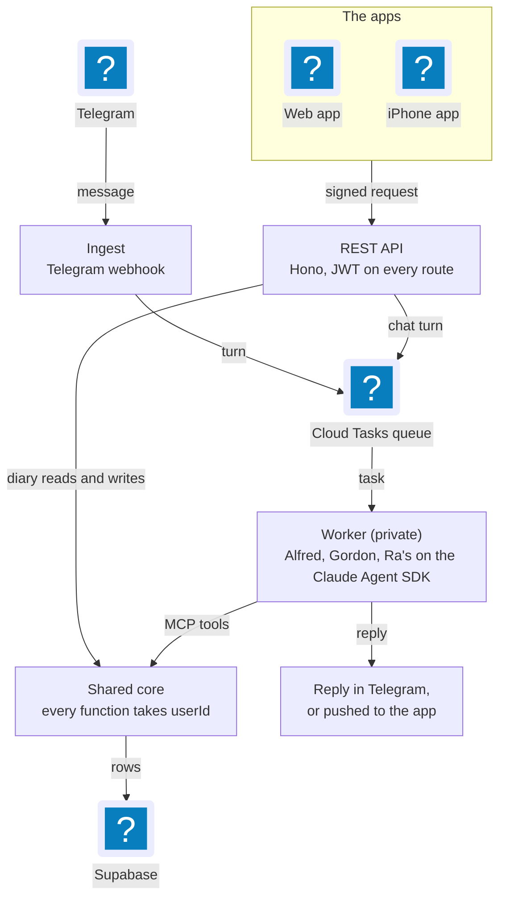
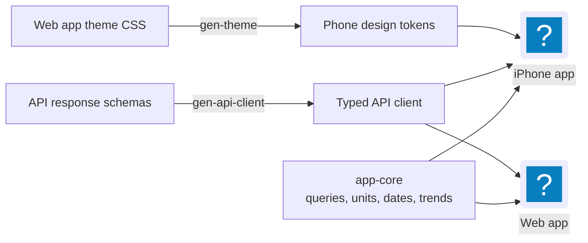

For its first few months the Batcave was a Telegram bot with one user (me), one front door (Telegram), and, as far as the code was concerned, no way for anyone else to ever exist. My user id lived in a module-level constant, and every food log, goal and workout quietly assumed it. That was fine right up until I wanted to open Gordon from my phone without going through a chat app.

[The first Batcave post](/blog/2026-06-01-behind-project-batcave-multi-agent-architecture) was the architecture as it stood in June: Alfred routing messages to Gordon and Ra's, Cloud Tasks in the middle, Supabase at the bottom. [Replacing MyFitnessPal](/blog/2026-10-22-replacing-myfitnesspal-before-punta-cana) was about what came out the other end: a web app, an iPhone app, Siri and a small Apple Watch app. This post is the part in between, the plumbing that had to exist before a second front door could open without breaking the first one.

Not much of it is glamorous, and a few of the guardrails only exist because I tripped over the exact thing they guard against.


## The user id was baked into everything

The first job was getting identity out of the code. `mcp/nutrition.js` was 483 lines mixing provider calls, nutrient math, date handling and five different domains, all behind a module-level `USER_ID`. Every function was single-tenant by construction.

So it got split into `core/`, one file per domain, and every function takes `userId` first:

```js
// core/log.js (trimmed)
export async function logFood(userId, { /* ... */ })
export async function editFoodEntry(userId, id, { /* ... */ })
export async function getDailySummary(userId, date, { includeFoodId = false } = {})
export async function getRecentHistory(userId, days = 7)
```

The MCP server kept only the tool contracts (the schemas and handlers Gordon actually sees) and resolves who's asking before calling into `core/`. Pure refactor, no tool schema changes.

### Who is user number one?

Then identity needed a table. A `users` table gives the existing BIGINT `user_id` a home and a second name, a nullable `auth_uid` pointing at Supabase Auth, so my Telegram account and a web login resolve to the same person. My row kept the id it always had (my Telegram id), so no table changed shape and no data moved. Web-registered users get ids from a separate sequence starting at 10^12. Telegram ids sit below roughly 10^10, so the ranges can't collide.

Row-level security came in the same PR. Being honest, it isn't what protects anything today: the worker, ingest and the evals all use the service-role key, which bypasses RLS. It's the second line. It closes the "one missing `.eq()` filter leaks everything" hole, and `scripts/verify-rls.js` runs 17 checks in CI against a throwaway Postgres to prove that a stranger with a valid JWT sees nothing.

## The API is a front door, not another agent

The REST API is a Hono app and the third Cloud Run service, next to ingest (the Telegram webhook) and the worker (where the agents run). All three come from the same Docker image with a different entrypoint. The API doesn't go through the MCP server and doesn't run an agent. Its routes call `core/*` directly, so when the app logs a food and when Gordon logs a food, it's literally the same function.

Auth is the whole security story, so the rule sits at the top of the file:

```js
// api/auth.js (trimmed)
//   userId is derived from a verified token, server-side, on every request.
//   It is never read from a path, a query string, a body, or a header.
```

A request that tries to name a user gets a 400 instead of being quietly ignored. The middleware is mounted on all of `/api/*` rather than an allowlist, and a test walks the real routing table and asserts every route returns 401 without a token. An allowlist fails open the day you add a route and forget it.

What made me pick Hono was `@hono/zod-validator`: the same Zod shapes validate HTTP bodies and Gordon's tool calls. The tool schemas moved to `core/schemas.js`, and I diffed every generated tool JSON Schema against main to confirm they were byte-identical, so the surface the evals test didn't move.

The API also holds fewer secrets than the worker. It never sees the Telegram token or the model keys, since it's the only public service that reaches the database.



*Three Cloud Run services from one image. The apps and Gordon meet at the same core functions.*

## Schema changes used to be pasted into a SQL editor

Before any of this, `db/schema.sql` was applied by hand in the Supabase SQL editor. It claimed to be idempotent. It also opened with `DROP TABLE IF EXISTS sessions CASCADE`, so re-running it would have silently wiped every live conversation thread.

`scripts/migrate.js` replaced it with a forward-only runner: files in order, one transaction each, and a sha256 per migration recorded in `schema_migrations`. If an applied file changes, it refuses to continue, because the database can no longer be rebuilt from the repo:

```js
// scripts/migrate.js (trimmed)
const drifted = migrations.filter(
  (m) => applied.has(m.version) && applied.get(m.version) !== m.checksum
);
if (drifted.length) throw new Error(/* names the drifted files */);
```

### Deploys that wait for the schema

Merging to main deploys all three services through Cloud Build about five minutes later, with nobody in the loop. Migrations are a command I type. For a migration the new code needs, that order is backwards. On 2026-09-14, code that needed a new `food_portions` table was live for 2h45m before the migration ran. Nothing broke only because nobody logged anything in that window.

Part of how that happened: I'd convinced myself the backend deployed manually, because `gcloud builds triggers list` without `--region=us-central1` answers "Listed 0 items" instead of erroring.

Now there's a gate in `cloudbuild.yaml` between build and deploy. `scripts/check-migrations-applied.js` compares the migrations in the image against what production has applied and fails the build if anything is missing. It only reads. Auto-applying would mean putting a DDL credential somewhere a build can see it, and I'd rather that step stay deliberate. A failed build fails safe: production keeps serving the previous revision.

## A dev database the evals can't escape

On 2026-08-15 an eval run without `EVAL_MODE=true` wrote 13 rows into my real diary. The flag changed a user id, not a destination. `SUPABASE_URL` always pointed at production.

The fix is one switch, `BATCAVE_ENV` (production or dev), and every dev credential is the production name plus `_DEV`. One switch instead of four overrides, because "the dev URL with the production service-role key" is exactly the state I wanted to be impossible to express. `EVAL_MODE=true` forces dev and throws if `BATCAVE_ENV` disagrees. If the dev and production URLs are the same value, startup throws. And every entry point prints its destination when it boots, because the 13-row incident was invisible in the output.

## Two apps, one layer that doesn't render

With the API in place, the web app (Vite, React 19, TanStack Query, on Vercel) and the phone app (Expo, React Native) needed to share something. The question was how much.

I looked at a `react-native-web` shim so the components could be shared too, and said no. It would make the web app depend on a React Native toolchain to render a food diary, which is a worse trade than retyping a card. So `packages/app-core` holds everything that's logic and nothing that renders: TanStack Query options and mutations, units, dates, trend series. The rule in its README fits in one line: no DOM, no JSX, no router.

It has zero runtime dependencies, ever. React, TanStack Query and the Supabase client are peer dependencies, and `scripts/check-peers.js` fails the build if anything shows up under `dependencies` or the two apps resolve different minor versions. The strictness is mostly about the Supabase client. Two copies of React announce themselves with "invalid hook call". Two Supabase clients just race the same rotating refresh token, which looks like being randomly signed out.

### Generate, don't share or copy

Some things can't be shared at all. React Native can't read CSS custom properties, so the phone can't use the web app's design tokens directly. The choice wasn't share or copy, it was generate or copy. `scripts/gen-theme.js` reads the `@theme` block from the web app's `index.css` and writes the mobile `tokens.ts`. The API client works the same way: `api/schemas/responses.js` is the source, and `scripts/gen-api-client.js` writes JSON Schema and TypeScript types into `packages/api-client`.

Both outputs are committed, and CI regenerates them and fails on any diff:

```jsonc
// package.json (trimmed)
"check:api-client": "node scripts/gen-api-client.js && git diff --exit-code packages/api-client/src",
"check:theme": "node scripts/gen-theme.js && git diff --exit-code apps/gordon-mobile/src/theme/tokens.ts"
```

Both generators throw on anything they don't recognise instead of guessing. A token the script can't classify is a token the phone would render wrong, and a failed build beats a grey rectangle. The design handoff's own copy of the theme had already drifted twice, which is how I know a hand-written TypeScript copy would have too.



*What the two apps get from the rest of the repo. Nothing on the left is edited by hand on the right.*

## Same queue as Telegram

The last piece was chat. The app's first chat endpoint held the request open for the whole turn, 20 seconds to two minutes, and a locked phone lost the reply. Now `POST /api/chat/messages` records the message as `pending`, queues the turn on the same Cloud Tasks queue Telegram uses, and answers 202 straight away. The worker's `/internal/chat-turn` claims the turn once (pending to running), so a redelivered task runs nothing, then writes the reply and marks the turn done or failed. Supabase Realtime pushes the new row to the app.

It didn't need new IAM either, since the API got the same enqueue permission ingest already had. Telegram and the apps only differ at the front door. Behind it, it's the same queue and the same worker running the same Gordon.


## Where two services still disagreed

More than one service means more than one place for a number to live. The latest example got fixed this week. The API accepts images up to 5 MB and forwards them to the worker as base64 JSON for label and receipt parsing, but the worker read every request body under a 1 MB cap. Base64 adds about a third, so anything over roughly 730 KB raw failed with a 400 from the worker, which the API reported as a 502. Same lesson as the theme tokens: `MAX_IMAGE_BYTES` moved into `core/schemas.js`, both sides read it, and a test sends a body of the advertised size.

The credential scan came from a similar gap. On 2026-08-23, `git add -A` swept the web app's `.env.local` into a commit. The ignore rule existed, on a branch that hadn't merged yet. Publishable key, private repo, so it cost about an hour, but nothing would have caught a worse one. `scripts/check-secrets.js` now checks what git actually tracks, never what `.gitignore` claims, and runs first in CI.

The other cost is surface area. Every front door is something you keep alive. The API had a text parse route for typed meals, and once typed meals started going to Gordon as a chat message, nothing called it. Thirty days of production logs backed that up, so it came out with its worker endpoint, schemas, fixtures and eval case: 1,378 lines across 23 files.

## What I'd tell myself in July

Mostly, move the user id out first. The API, RLS and both apps were straightforward because `core/` already took `userId` as its first argument, and if a bot might ever get a second surface, that's the day-one change. After that: when two things have to agree, generate one from the other or have both read the same constant. Every time I let two copies exist (the design tokens, the image limit) they drifted, and CI only caught the ones it was regenerating.

It's still just me using it, but the code doesn't assume that anymore. Next up is memory, where I thought Gordon had four tiers and then read the code.

---

*Built with Hono, the Claude Agent SDK, Supabase, Cloud Run and Cloud Tasks, with the apps on Expo and Vite (web on Vercel).*
