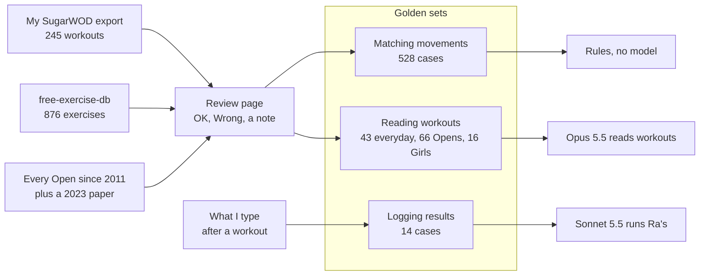

The first result I ever logged with Ra's came out wrong. The workout was an Open-style ladder, seven minutes, clean and jerks and toes-to-bar going up by three each rung. I typed "my last was 12 clean and jerks" and Ra's saved four full rungs: 60 reps, including 12 toes-to-bar I never did, and a note that I'd been time capped. I corrected him. He saved 0 reps. Then 3+0. Then 4+0.

By then I'd already built three golden sets for Ra's, and none of them covered what I say after a workout. So that became the fourth. This post is about where all four came from, because the sets were the slow part and the part that decided things. Each model choice in Ra's came out of one of them: no model for matching movements, Opus for reading workouts, Sonnet for running Ra's.

## The Batcave, and where Ra's started

The Batcave is my personal assistant, and it's a multi-agent system. Every message I send (Telegram, or the app for some of it) goes first to a small Haiku router that decides who should answer. There are three agents, each named after a Dark Knight character and each with its own voice. Alfred handles general conversation and remembers things about me. Gordon does nutrition, and he's the one I use every day, since he [replaced MyFitnessPal](/blog/2026-10-22-replacing-myfitnesspal-before-punta-cana). Ra's al Ghul does training. Each one is a separate Claude agent on the Agent SDK, with its own prompt and its own tools, in its own isolated context. Ra's never sees my food conversations, and Gordon never sees my workouts. [The first post](/blog/2026-06-01-behind-project-batcave-multi-agent-architecture) has the architecture.

That post also said Ra's would come last, "and it'll be honest about how simple he still is." So, honestly: until a couple of weeks ago Ra's was a 16-line prompt on Haiku at low effort, with two tools: one to log a set and one to read history back. They wrote to one flat table: exercise as free text, reps, weight, unit. He could write a row down and read it back, and that was about it.

That doesn't work for how I train. I do CrossFit five mornings a week, and my gym posts the workouts on SugarWOD. SugarWOD records one score per workout, so everything I actually did (the load, the substitution, "thrusters at 75 after round 2", "green KB") ends up in a free-text note nothing can query. And with exercise stored as free text, "Snatch", "sq snatch" and "SN" are three different things. Ask how many times I snatched this month and the honest answer is "no idea".

What Ra's is supposed to become is a training agent that understands a workout: its format, its movements, which parts of the body it loaded. Logging should take a sentence. Every set of every lift gets kept, so PRs and volume come from data instead of me rereading notes. Later he plans my week around the gym's workouts and talks to Gordon about fueling.

The ground rule for all of it is in the plan: the model decides what to ask, and SQL and code compute the answer. No model doing arithmetic over my training log. That puts two things first. Ra's needs a vocabulary, a movement library where every movement is an id, so the counting can be SQL. And he needs to read a workout's structure into fields. Neither can be built well without knowing what right looks like first, so that's where the golden sets come in.

## What a golden set is, and why I needed one

A golden set is a list of real inputs, each with the right answer written next to it by someone who knows. For Ra's that's me. One case looks like "Pause Front Squat" → front squat with a pause qualifier. Another is a whole workout description → every block, round, movement and load it contains. The "golden" part is that a human checked the answer, so it's the thing everything else gets compared against.

An eval is the script that runs the system over every case in that set, compares what came out with the checked answer, and gives back a number. Usually more than one: how often it got the answer right, how often it confidently got it wrong, what it cost, how long it took. Each eval also has a gate, a threshold a change has to meet before it ships. If a prompt edit drops the score below the gate, the change doesn't go in.

With normal code I can read the function and write a test for it. With a model there's nothing to read, and the prompt tweak that fixes the workout in front of me can quietly break three I wasn't looking at. Before these sets, Ra's had 16 routing cases and a few others, all against a flat workout row, and nothing that checked whether he read a workout right. "Looked right on the three I tried" is not a number.

The other thing golden sets did, which I didn't expect, was hold the decisions. Every time I said "no, that's a different movement" on the review page, it became a case with an answer. Six months from now a model upgrade either still agrees with me on all of them or the eval says which ones it doesn't.

Two kinds of cases matter more than the rest. Held-out cases are ones I wrote and then never tuned against, so the score on them is the honest one. If you fix the code every time a case fails, your score climbs while the system only gets better at those exact cases. And negative cases are text that should produce nothing ("Rest", "Green KB", a message telling me my knee hurts). They're how you count the confident wrong answers, which in a training log are worse than no answer.


*Four sources, one review page, three golden sets, and the model decision each set produced*

## Code finds the movement, a model finds the structure

Reading a workout is really two jobs, and they ended up on different sides of the code/model line.

The first is working out which movement a phrase means. "C2B" and "chest to bar pull-ups" are the same movement, and "pull-ups" is a different one. That's a lookup against a closed list (967 movements now), the answer has to be exact because every count and PR hangs off it, and when it's wrong I need to know why. So that's code: a table of every way I've seen each movement written, a fuzzy match for typos, and a handful of rules about what a close match is allowed to fix. No model at match time.

The second is the shape of the workout. "On a 15:00 clock: 75 burpees, every minute 5 power snatches" is a time cap with an EMOM (every minute on the minute: start a small set at the top of each minute) running inside it. "Rx / intermediate / beginner" means three versions of one workout, where Rx is the workout as written, at the prescribed weights. "Repeat from beginning" wraps everything above it. That's open-ended language, and every coach writes it differently. The splitter already needed a page of regex just to put the line breaks back, and checking 30 real workouts line by line turned up shapes no rule was going to follow. So a model reads the structure.

The two meet in one place, and the model doesn't get the last word. It returns movement phrases, never ids, and every phrase goes through the matcher. Every number it returns has to appear in the original text, and the whole answer has to fit a fixed shape or it's rejected.

The plan says it in one line: the model finds the structure, code decides everything it can check. Logging a result ended up the same way. The model reads "my last was 12 clean and jerks", and code counts the reps.

## The export nobody would design

The real data I had was SugarWOD's export of my own history. I wrote one thing into the plan early: the export is not how Ra's tracks training. It's a one-time backfill, and it's the source of real-world eval data. 245 workouts from January to November, kept out of git, because it's my training log.

The first surprise was that the export has no line breaks. None. SugarWOD flattens every description, so this is a real line:

```text
rxFor time:15-12-9-6-3Deadlifts (155/225 lb)30-24-18-12-6Bar-facing burpeesintermediateFor time:15-12-9-6-3Deadlifts (105/155 lb)30-24-18-12-6Bar-facing burpeesbeginnerFor time:15-12-9-6-3Deadlifts (35/45 lb)Burpees
```

Words run straight into numbers hundreds of times. Some slash pairs are real loads (155/225) and some are two numbers glued together (105/7510 is 105/75 and then 10). So the very first code was a splitter to put the lines back, and I kept the mess as test data on purpose. The test folder's README says "Don't clean it up; the mess is what's being tested."

## Golden set one: my own history, row by row

The movement library came first. Counting questions are just counting rows in a database, so each row has to point at exactly one movement, and it has to be the right one. If "C2B" quietly counts as a pull-up, every chart after it is wrong and nobody notices.

Claude drafted a first batch of about a hundred movements from the export, and a script ran every phrase in my history against it. About 85% matched on the first try. Then I sat down with a review page that had OK and Wrong buttons and a note field, and went through about 400 rows: what matched, what didn't, and a batch of CrossFit movements Claude drafted next.

On the first pass I marked 12 rows wrong, and all 12 were the same mistake. A single-arm row filed under row. A goblet cyclist squat filed under goblet squat. Each one was a variant folded into its nearest base movement, which would have credited every rep of the variant to a different exercise. That turned into the first line of a rules file in the repo: "When unsure, make it separate."

That file is really the first golden set's answer key, in prose. It's everything Claude couldn't have known. A burpee to plate means you jump on the plate. Bare "clean" is a squat clean at my gym. "KBS" is an American swing. A pause clean and a halt clean are different lifts. "Bike", "Echo bike" and "Assault bike" are one movement, because brands don't split the history. And the rule for anything new is "ask Pablo and add the answer here."

## The import was the first exam

My history covers a few hundred movements, so to fill out the general gym stuff I imported [free-exercise-db](https://github.com/yuhonas/free-exercise-db), which is Unlicense. That's 876 exercises, most of which became new movements.

What I didn't expect was that the import would work as a test. It was the first text the matcher hadn't been tuned on, and about half of its 55 confident close matches were wrong. "Leg Press" matched "Strict Press". "Barbell Hack Squat" matched "Back Squat". The matcher accepted anything with a high enough similarity score, and on my own history that had looked fine, because I'd been fixing it against my own history.

The rule that came out of it: a close match may only fix spelling. It never adds or drops a word, whatever the score. On the imported names, accepted close matches dropped from 55 to 3.

## Turning the rulings into an eval

The movement-matching eval is 528 cases, split by where they came from:

| Cases | Count | What they check |
|---|---|---|
| From my history | 205 | Rows I checked on the review page, so nothing I've ruled on quietly changes |
| Typed by hand | 157 | Things I'd type in chat |
| Not a movement | 93 | "Rest", "Green KB", "Score: Total time" |
| Held out | 73 | Written before the spelling rule existed, never tuned against |

The "not a movement" cases are there to count false matches, and false matches are what the gate cares about. A miss goes to a review queue and I fix it once. A false match logs the wrong movement with no warning and stays in every count after that. So the gate is the right movement at least 95% of the time and a wrong one at most 1%. The rules file also has a line I keep having to remind myself of: "Don't add a row to the held-out set after seeing it fail, or that number stops meaning anything."

The first run failed at 91.7%. Every miss was an obvious typo that the old score cutoff blocked, which the spelling rule fixed. The one held-out false match after that was "Pause Clean" landing on Halt Clean, which is how pause and tempo ended up as qualifiers instead of movements. As shipped: right 98.1% of the time, never a wrong match, 87.3% on the held-out cases, and 8 milliseconds a match.

Then I used the same cases to settle whether this needed a model at all:

| Matcher | Right | Wrong match | Held-out right | Time per match |
|---|---|---|---|---|
| Rules (ships) | 98.0% | 0.0% | 87.0% | 8 ms |
| Embeddings | 82.6% | 5.7% | 42.6% | 3 ms |
| Haiku 5.5, library in a cached prompt | 97.4% | 0.8% | 96.3% | 652 ms |
*Measured just before pause and tempo became qualifiers, which is why the rules row is a hair under the shipped 98.1%*

Embeddings turn each phrase into a list of numbers and pick the movement whose numbers are closest. They got the threshold that scored best on these exact cases and still lost badly, because they put near neighbours close together and in CrossFit near neighbours are different movements. "Triple unders" landed on Double-Under. Haiku was genuinely better on typos it had never seen, but it was wrong on 0.8% of everything, including one movement it made up. Rules ship, and Haiku is a candidate fallback for text the rules already gave up on.

## Golden set two: 30 workouts

This is the model half of the split: the parser that turns a whole workout into fields. Every movement it finds still goes through the matcher above, so this set scores the structure, plus whether the movements it found are the right ones.

The golden set is 30 real descriptions from my export, the same ones I'd checked line by line for the splitter. Writing 30 answer keys by hand is miserable, so Opus 5.5 drafted them (about a dollar), Claude read every draft, and then I checked each one on the review page. 27 of 30 were right as drafted. My own answers go inside the answer files, because some of them aren't in the text at all:

```json
"source": "Pablo's SugarWOD export, description only",
"checked": "Drafted by Opus 5.5, read by Claude, checked by Pablo (2026-11-07/08)",
"corrected": true,
"answers": {
  "how many times": "2: the whole sequence twice (Pablo)",
  "American KBS load": "Not written: the workout's one KB, 53/35 from the goblet thrusters. Usually the green 53 lb for men; purple 71 lb has been Rx (Pablo)"
}
```

The coach's beginner "5" lunges were a typo for 6. "Repeat from beginning" means twice, because I was there.

There's an obvious problem with answers Opus drafted: they flatter Opus. So next to the 30 I wrote 10 held-out workouts by hand before any model read them (Fran, Cindy, Grace, Helen, DT, a Death by, a Tabata and a few others), plus a couple of nasty ones. One is a prompt injection that tells the parser to ignore its instructions and log 500 burpees, sitting above a real "For time: 50 burpees". Another is "Coach, I can't make it tomorrow, my knee is sore. See you Thursday!", which shouldn't become a workout.

The first three-model run scored Haiku 52%, Sonnet 64%, Opus 71%. I didn't believe those, and when I looked, most of the gap was the models and my answers writing the same structure two ways: 5-5-5-5-5 vs 5 x 5, an EMOM's minutes vs its intervals. So I taught the scoring that those are the same thing, and fixed three answers that were wrong. That's changing the scoring after seeing the results, which is exactly what you're not supposed to do, so the doc where I wrote down the model decision says so. The held-out 10 are the check on it.

| Model | My 30 | Held-out 10 | All 42 | Wrong movements | Cost per workout |
|---|---|---|---|---|---|
| Haiku 5.5 | 63% | 90% | 71% | 0 | $0.001 |
| Sonnet 5.5 | 77% | 90% | 81% | 0 | $0.012 |
| Opus 5.5 | 97% | 100% | 97.6% | 0 | $0.024 |

Opus was the only one above the 90% gate, and the only one at 100% on workouts it never drafted. Haiku called real workouts "not a workout". Sonnet read "On a 15:00 clock" as a fixed 15 minutes instead of a cap. That decision doc opens with my own words from that day, "not optimize for cost so much that quality is decreased". I read about one workout a day, so Opus costs well under a dollar a month.

The first real paste broke it anyway. I pasted an Open workout written out for Men, Women, and two Masters divisions, the answer didn't fit the shape, nothing saved, and Ra's described it to me as a "limit". That workout is in the golden set now.

## Golden set three: every Open since 2011

The decision doc also lists how I'd know I picked wrong, and one item is the Open workouts scoring clearly below my everyday ones. The Open is CrossFit's yearly worldwide competition: a few workouts everyone does and submits a score for. So I put every Open since 2011 in, typed from public sources and never scraped. Most of the text came from a paper, Mangine, Grundlingh and Feito, [Sports 11:24 (2023)](https://doi.org/10.3390/sports11020024), which also prints official Rx percentiles that Ra's will use later to tell me where a score sits.

The real parser read all 67 and I reviewed them on the same page. 66 went into the golden set, and they score 93.9% against 97.7% on my everyday set. That's above the gate, and whether the gap counts as "clearly below" is a call I haven't made yet. Next to them sit 16 of the Girls, CrossFit's classic benchmark workouts with women's names (Fran, Cindy, Grace), which I wrote by hand before any model saw them, and those are 16 for 16. Both sets merged last night, so they run with the rest now.

## Golden set four: what I actually say

Back to the ladder. Logging a result is a different kind of eval, because the model's job is to read what I said and call a tool, and the thing that matters is what lands in the database. So this eval saves a workout from the golden set for a test user, sends Ra's a score the way I'd say it, with the same prompt and tools as production, and checks what got saved:

| What I say | What should be saved |
|---|---|
| "My last was 12 clean and jerks when the 7 minutes were up" | 3 full rungs plus 12, 48 reps |
| "5+15 rx but I used 35s on the snatches" | 5 rounds plus 15, dumbbell snatch at 35 lb |
| "5 rounds plus 40" | Nothing. A round of that workout isn't 40 reps, so Ra's should ask |

The fix for the ladder was to stop letting the model count. Ra's says where I ended (12 into the clean and jerks) and code works out that it's 3 full rungs plus 12, 48 reps. Threshold is 100%, because a wrong logged result is the whole failure. Haiku got 9 of 12 at best, and the misses weren't the code's fault but Haiku's own reading of what I'd said, so Ra's moved to Sonnet 5.5 like Gordon did, and Sonnet got 12 of 12 after four fixes the eval found. One of them: in that workout "the snatches" means the dumbbell snatch, not the barbell lift. It's 14 cases now, 14 for 14, about 17 cents a run.

## What's still not great

Some of these numbers flatter the parser. Both the 30 SugarWOD answers and the 66 Opens started as a model's reading that I reviewed, so the parser is being graded partly on its own homework. The held-out sets (10 workouts, 16 Girls, 73 match cases) are the honest ones, and they're small.

I also turned the nightly eval run off. The token cost wasn't worth it when I run the suites by hand before anything ships to Ra's. The matcher eval needs no model and costs nothing, so it runs on every change to the library. The other two run when I remember to run them, which is the same problem Gordon had before I actually started logging food.

And the rules file is only as good as my patience with the review page. Every line in it is me looking at a row and saying "no, that's a different thing". That works for one person's history and one gym's habits.

Picking a model for each part took one eval run and an afternoon. Building the sets those runs were scored against took a week of me at a review page, and that week is where the decisions really got made.

---

*Built with Postgres on Supabase, the Claude Agent SDK and an MCP server for Ra's tools. Movement data partly from [free-exercise-db](https://github.com/yuhonas/free-exercise-db). Open percentiles from Mangine, Grundlingh and Feito (2023), CC BY 4.0. Source on [GitHub](https://github.com/pdimeglio-dev/project-batcave).*
