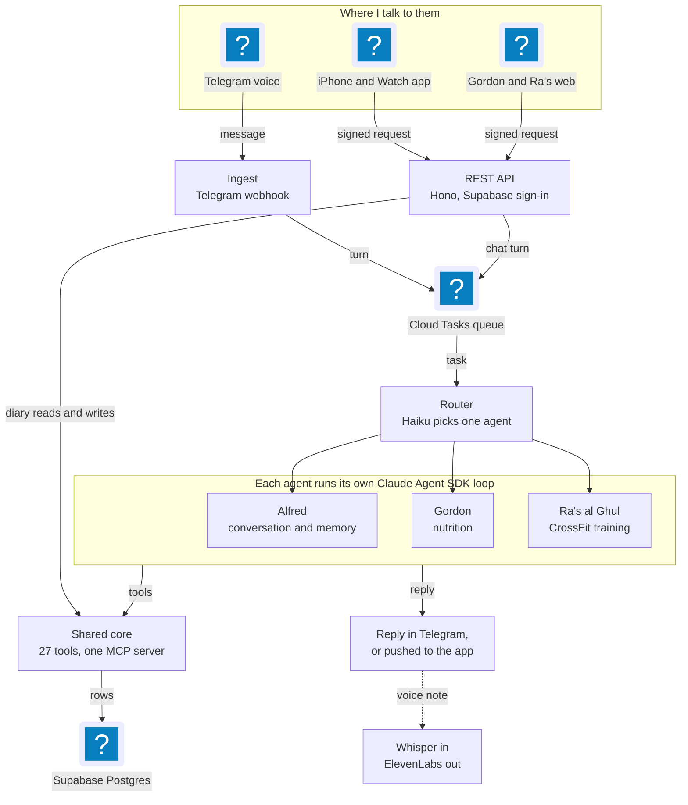

Batcave started in February 2026 as a Telegram bot on a free-tier GCP VM: one butler, a voice loop, and a process manager keeping it alive. It's now three agents I use every day, running on Cloud Run on the Claude Agent SDK, each with its own tools, and with apps built around them.

Most people are building Jarvis. I went with a different superhero universe.

### How It Runs

*Three Cloud Run services that scale to zero. Telegram and the apps share one queue, one worker and one set of tools.*

* **Three Cloud Run services that scale to zero.** A public webhook takes Telegram messages, checks the secret token, drops duplicates and queues the turn on Cloud Tasks. A private worker runs the turn. A REST API (Hono, Supabase auth, about 35 routes) serves the apps. Chat from the apps goes through the same queue and worker as Telegram, so an agent behaves the same wherever I talk to it.
* **A router picks the agent.** A small, fast model (Haiku) reads each message and names one agent. A short reply like "yes" stays with the agent that just asked the question. It's checked against a 46-case routing eval on every pull request and again before every deploy.
* **One Agent SDK loop per agent.** Each agent runs its own `query()` loop with its own model, tool allowlist, turn limit and a $0.50 cap per turn. Nothing loads from settings files on disk, and any tool outside the allowlist is denied.
* **Agents can ask and wait.** When an agent needs an answer from me, the question is saved in Postgres and the turn stops. When I reply, even hours later and after the container has restarted, the session resumes where it left off.
* **Tools live in one in-process MCP server** with 27 tools shared by the agents.
* **Data in Supabase Postgres** with separate dev and prod projects, row-level security, and 36 forward-only migrations. A deploy is blocked until production has every migration.
* **Deploys on every merge.** Cloud Build builds, checks migrations, runs the routing eval, deploys all three services and re-registers the webhook. About five minutes, no manual step.
* **Voice is still there.** Telegram voice notes go through Whisper, and each agent answers with its own ElevenLabs voice.

### The Agents

* **Alfred** handles general conversation, remembers facts about me, and catches anything the router can't place.
* **Gordon** is the nutrition agent, and replaced MyFitnessPal for me. He searches USDA and Open Food Facts, reads nutrition labels, barcodes and grocery receipts from photos, adapts calorie targets to my goals, and tracks weight, water, caffeine, saved meals and a pantry. (The name is also a deterrent: "don't get gordo.")
* **Ra's al Ghul** is the CrossFit coach. I paste a workout the way it's written on the gym whiteboard. A model reads the structure (rounds, reps, time caps), then code matches every movement against a curated movement library, so the model never gets the last word on what I actually did. He tracks lift bests and repeated benchmark workouts over time.

### The Apps

* **Gordon for iPhone and Apple Watch.** Expo and React Native, with hold-to-talk, offline logging, push notifications, a Siri shortcut ("Talk to Gordon") and a watch app in SwiftUI. Most changes ship as over-the-air updates. A full build only happens when native code changes.
* **Gordon web and Ra's web.** React 19, Vite, TanStack Query and Tailwind on Vercel. Ra's web covers logging, history, lift bests, and answering Ra's questions with a tap. Ra's phone app is next.
* Both talk to the API through a shared, generated API client.

### How I Build It

* **Plan first.** Every feature starts as a written plan that gets committed with the work (39 so far). Bigger calls get a decision record.
* **Evals as gates.** 13 eval suites cover routing, tool choice, faithfulness, memory recall, cost ceilings, photo reading and workout parsing, including a 30-workout golden set and 526 movement-matching cases. A model change only ships if the evals hold.
* **A bug pipeline run by Claude Code agents.** `/bug` files a GitHub issue and a triage agent investigates it without edit access, then posts a hypothesis and a status. `/fix` starts a fixer agent per ready issue, each in its own git worktree, and each opens a pull request assigned to me. Agents never merge. `/release` ships to my phone as one over-the-air update or one build, with a test checklist issue.
* **Stacked pull requests** for features that span the API and the apps.

### Key Achievements

* **Production agent system on the Claude Agent SDK:** three agents with isolated sessions, tool allowlists, per-turn cost caps, and questions that survive restarts.
* **Serverless on GCP:** Cloud Run, Cloud Tasks and Cloud Build with fully automated, eval-gated deploys.
* **Native and web apps:** an iPhone app with an Apple Watch companion and Siri, plus two web apps, all on one API.
* **Eval-driven development:** 13 eval suites and about 800 backend tests, with routing evals gating every pull request and deploy.
* **Agentic engineering workflow:** written plans, decision records, and a bug pipeline where triage and fixer agents open pull requests for me to review. 280+ merged pull requests since April 2026.
