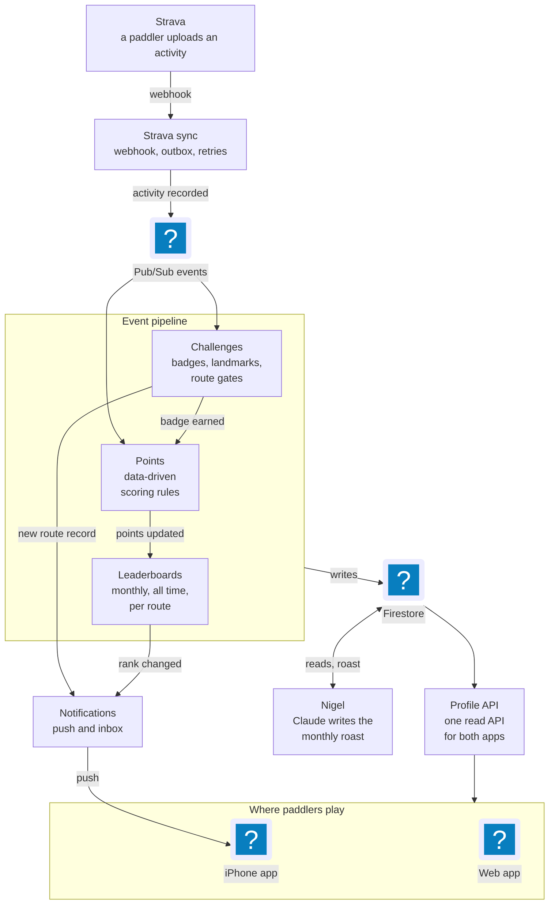

The Paddle Games is a community-driven leaderboard platform for Bay Area paddle sports enthusiasts. It connects with Strava to automatically track kayaking, stand-up paddleboarding, canoeing, and surfing activities — ranking paddlers on weekly, monthly, and all-time leaderboards powered by a fully data-driven gamification engine.

Designed, built and launched solo, from product idea to production, on the web and as a native iPhone app on the App Store. It has close to 100 paddlers, with a growing community on Instagram.

### Native iPhone App

The mobile app is built with Expo and React Native, and shares its API clients, data models and TanStack Query hooks with the web app through a shared core package, so a feature built once works on both. It signs in with Strava, sends push notifications for new personal records, new route leaders and rank changes, and ships most changes as over-the-air updates instead of new store builds. Getting through App Store review meant building a demo account the reviewers could use, kept out of the real leaderboards and blocked from writing to Strava.

### Event-Driven Microservices Architecture

*Seven services on Google Cloud, wired by events. Nothing in the activity pipeline calls another service directly.*

The backend is a serverless, event-driven system on Google Cloud Platform with 7 independent microservices communicating asynchronously via Pub/Sub:

* **Auth Service** — Strava OAuth flow, JWT issuance, and token lifecycle management
* **Strava Integration Service** — Webhook ingestion, activity enrichment, and geographic filtering
* **Points Calculator Service** — Data-driven scoring rules engine
* **Challenges Service** — Badge evaluation with a pluggable evaluator pattern
* **Leaderboard Service** — Read-optimized materialized views for rankings
* **Profile Service** — Stateless API aggregator for the web and mobile apps
* **Notifications Service** — Push notifications to the mobile app for personal records, new route leaders and rank changes

Each service subscribes only to the events it cares about, enabling independent scaling, deployment, and evolution.

### 100% Data-Driven Gamification

The entire points and challenges system is defined as data — no code changes are needed to add new scoring rules, challenges, or badges. Everything is stored in Firestore and evaluated at runtime:

* **Scoring Rules Engine:** A flexible, condition-based rules engine supports per-unit scoring (e.g., points per kilometer) and fixed-point bonuses. Rules can target any combination of activity attributes — distance, duration, sport type, time of day, day of week — enabling creative reward mechanics like early morning bonuses or long-distance achievements.

* **Pluggable Challenge Evaluators:** A generic evaluator pattern supports multiple challenge types — from simple milestones and single-activity achievements to location-based challenges and multi-step scavenger hunts. New evaluator types can be added without modifying the core evaluation loop.

### Geo-Spatial Challenge System

Location-based challenges are powered by GPS data from Strava activities:

* **Polyline Decoding & Analysis:** Strava activity polylines are decoded and analyzed against a library of spatial assets — points, lines, and polygons representing local landmarks and waterway waypoints.
* **Landmark & Route Detection:** The system detects when a paddler passes within a configurable radius of defined locations, enabling discovery challenges and guided waterfront tours.
* **Route Challenges and Personal Records:** Paddlers complete defined routes, get their own history and best times on each one, and get notified when they set a record or someone takes the lead.
* **Map Editor:** An admin map editor for drawing landmarks and routes, with draggable pins and editable route points.

### Key Achievements

* **Solo Full-Stack Product:** End-to-end ownership of product design, a 7-service backend, the React 19 web app, a native iPhone app on the App Store, GCP infrastructure, Strava integration and community building.
* **Shipped to the App Store:** Expo and React Native app sharing a core package with the web, push notifications, over-the-air updates, and a review-safe demo account.
* **Data-Driven Architecture:** Scoring rules, challenge definitions, badge configurations, and spatial assets are all stored as data — making the entire gamification layer extensible without code changes.
* **Real-Time Event Pipeline:** Strava webhooks trigger an asynchronous pipeline through activity processing, points calculation, challenge evaluation, and leaderboard updates.
* **Geo-Spatial Challenges:** GPS polyline analysis, landmark proximity detection, sequenced waypoint validation, and route challenges with personal records.
* **Production Community:** close to 100 paddlers, automated activity ingestion, Instagram community, and a freemium business model with local sponsorship strategy.
